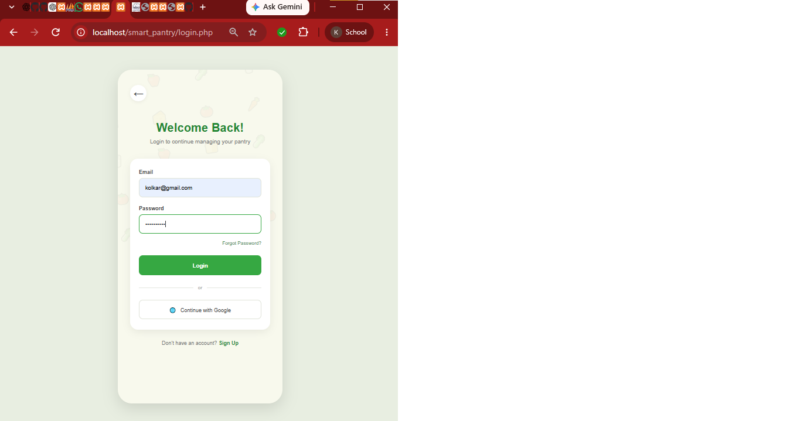
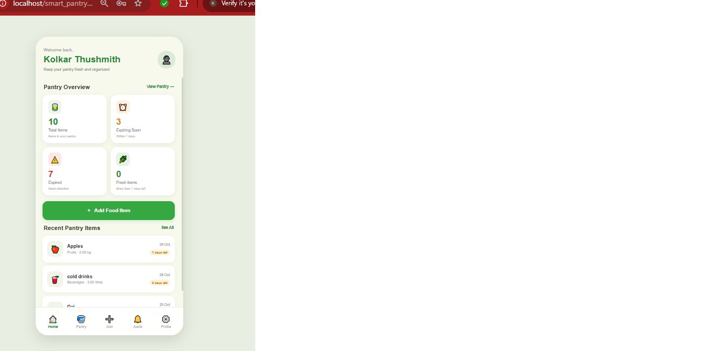
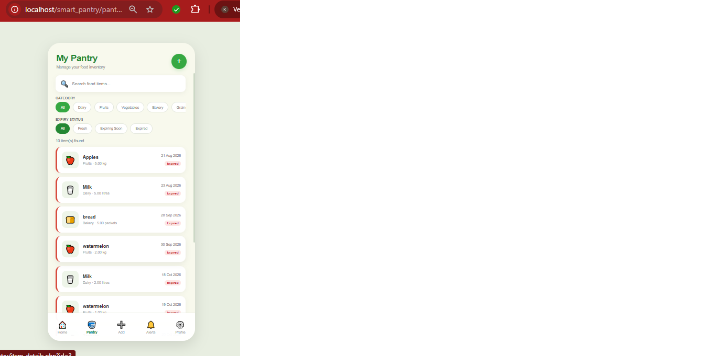
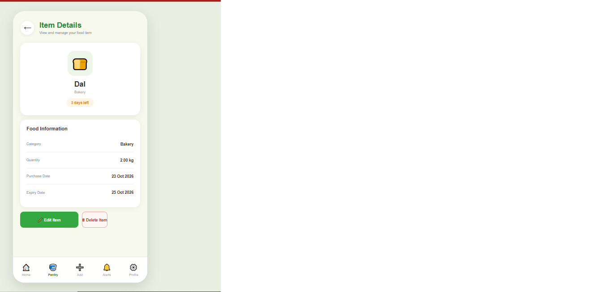
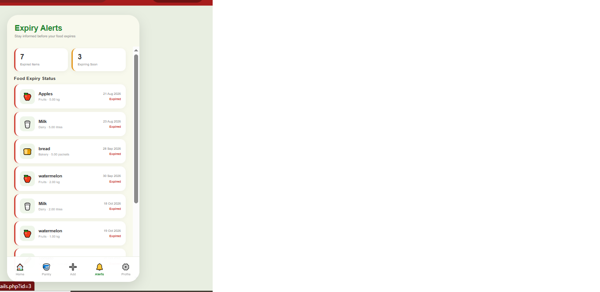
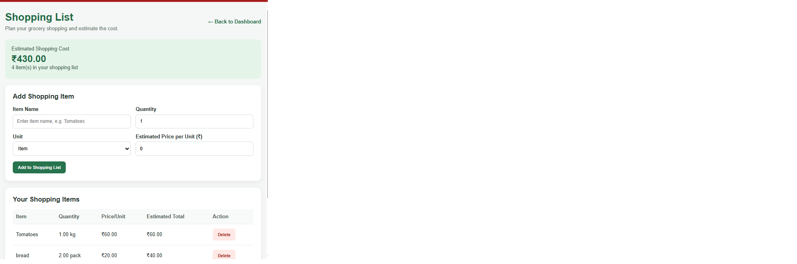
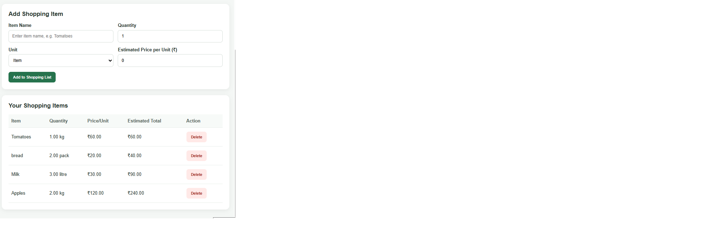
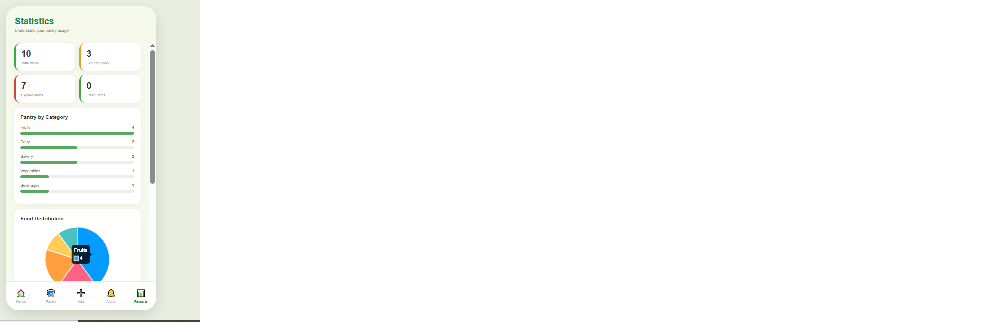
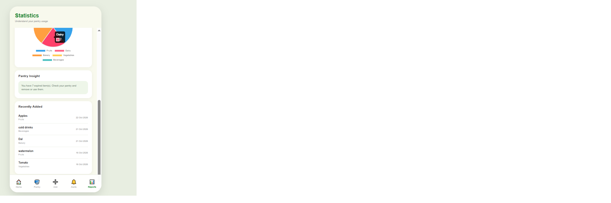
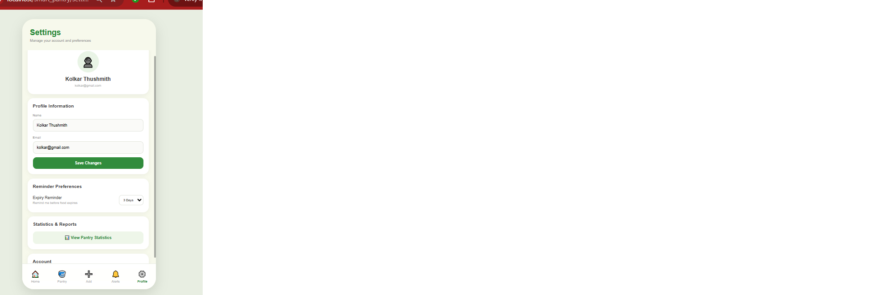

# Smart Pantry – Food Inventory & Expiry Tracker

A PHP and MySQL web application for managing food inventory, tracking expiry dates, and estimating grocery expenses.

## About the Project

Smart Pantry helps users organize pantry items, monitor food expiry dates, plan grocery shopping, and manage monthly grocery budgets. The project aims to reduce food waste, avoid unnecessary purchases, and make household grocery management easier.

## Features

- User registration and login
- Dashboard with pantry summaries
- Add and manage food items
- Expiry alerts and notifications
- Item details and inventory management
- Monthly grocery budget tracking
- Shopping list with estimated costs
- Shopping trip budget management
- Statistics and profile settings

## Technology Stack

| Technology | Purpose |
|---|---|
| HTML | Page structure |
| CSS | Styling and layout |
| JavaScript | Interactive features |
| PHP | Backend processing |
| MySQL | Database |
| XAMPP | Local development server |
| Git | Version control |
| GitHub | Source code hosting |

## Application Screenshots

### Login Page

### Dashboard

### Add Food Item

### Pantry Management

### Item Details

### Expiry Alerts

### Monthly Budget

### Shopping List

### Shopping Trips

### Statistics

### User Profile

## Installation and Setup

### Requirements

- Windows
- XAMPP
- PHP
- MySQL
- A web browser

### Steps

1. Install XAMPP and start Apache and MySQL.
2. Clone or copy the project into the XAMPP `htdocs` folder.
3. Create a MySQL database named `smart_pantry` using phpMyAdmin.
4. Create the required database tables using your project's database schema.
5. Configure the database connection locally in `config/database.php`.
6. Open the application in your browser:

   `http://localhost/smart_pantry/`

7. Register an account or log in to use the application.

Note: Database setup and configuration are required before running the application. Do not publish passwords, private credentials, or databases containing personal information.

## Budget Calculation

The monthly budget page calculates recorded spending from pantry food purchases for the selected month.

The shopping list estimates planned grocery costs using the quantity and estimated unit price of each item. Planned shopping costs and recorded spending are tracked separately.

## Project Objectives

- Reduce food waste through expiry tracking.
- Improve pantry inventory organization.
- Help users plan grocery purchases.
- Estimate shopping costs before purchasing.
- Track monthly grocery expenses.
- Provide an organized food management experience.

## Future Enhancements

- Improved reminder functionality
- Enhanced analytics and visualizations
- More detailed expense reports
- Improved mobile responsiveness
- Additional grocery planning features

## Author

**Kolkar Thushmith**

GitHub: [kolkarthushmith2023-art](https://github.com/kolkarthushmith2023-art)

## Project Status

Academic project under development.

## License

No license has been specified.
